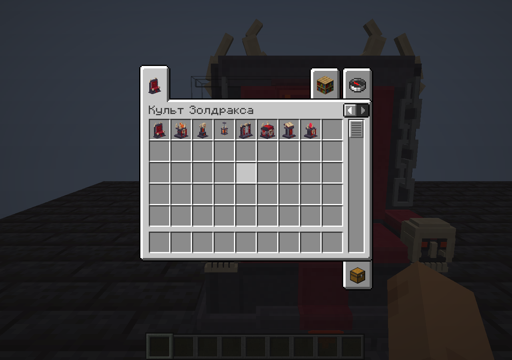
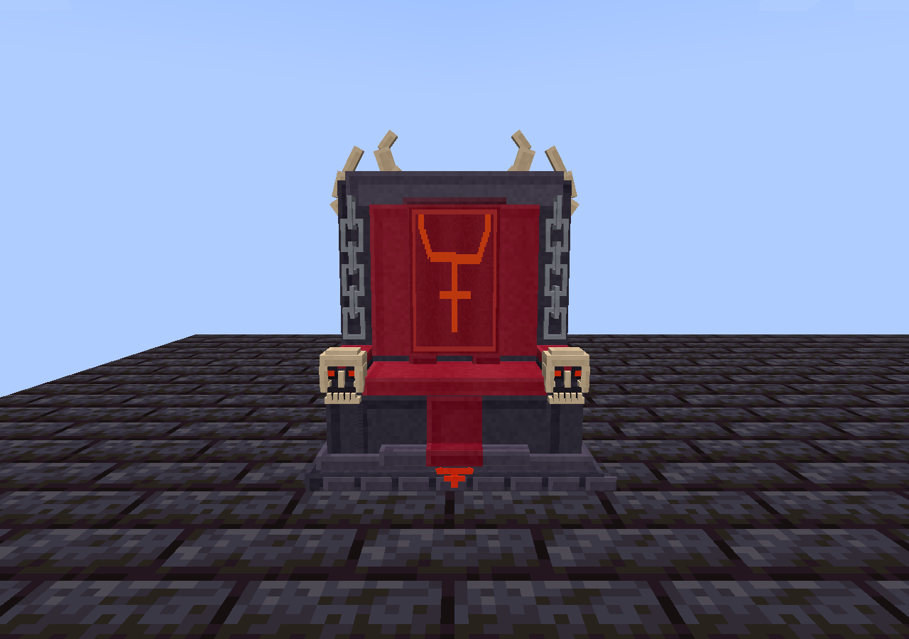
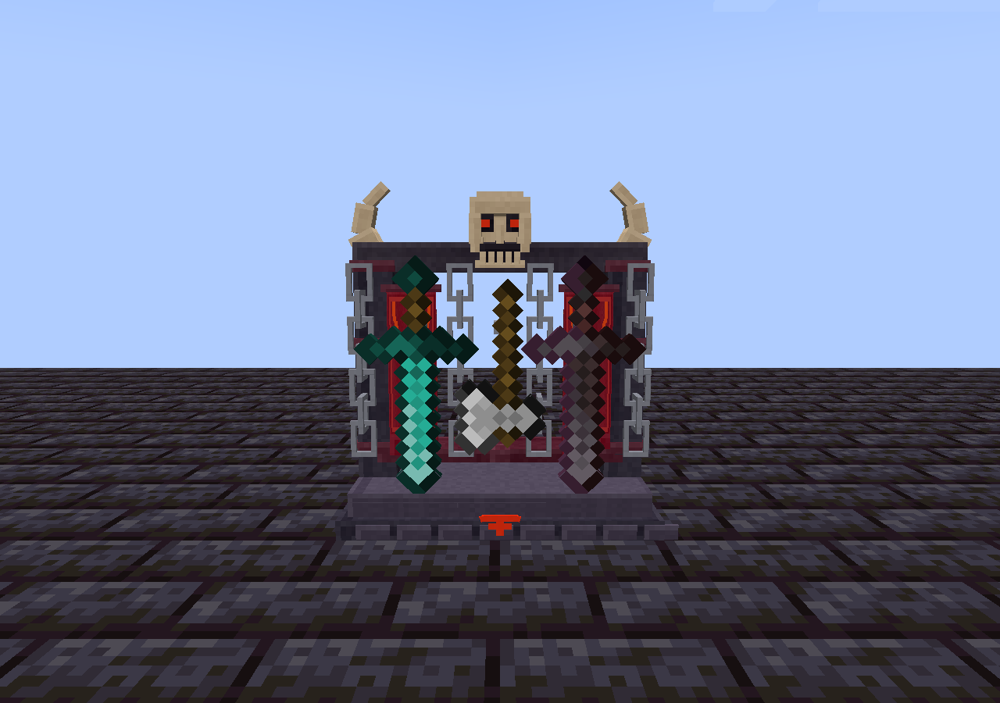

# Игровые снимки 1.11.0

Настоящий Minecraft 1.20.1 / Fabric, Xvfb + Mesa. Обычное блочное освещение тестовой площадки, без ночного зрения. Исходные снимки не ретушировались.

| Объект | Спереди | Сбоку | Сзади | Сверху |
| --- | --- | --- | --- | --- |
| throne | [front](zoldrax_throne-front.png) | [side](zoldrax_throne-side.png) | [back](zoldrax_throne-back.png) | [top](zoldrax_throne-top.png) |
| brazier | [front](zoldrax_brazier-front.png) | [side](zoldrax_brazier-side.png) | [back](zoldrax_brazier-back.png) | [top](zoldrax_brazier-top.png) |
| skull_lamp | [front](zoldrax_skull_lamp-front.png) | [side](zoldrax_skull_lamp-side.png) | [back](zoldrax_skull_lamp-back.png) | [top](zoldrax_skull_lamp-top.png) |
| chain_lantern | [front](zoldrax_chain_lantern-front.png) | [side](zoldrax_chain_lantern-side.png) | [back](zoldrax_chain_lantern-back.png) | [top](zoldrax_chain_lantern-top.png) |
| weapon_rack | [front](zoldrax_weapon_rack-front.png) | [side](zoldrax_weapon_rack-side.png) | [back](zoldrax_weapon_rack-back.png) | [top](zoldrax_weapon_rack-top.png) |
| chest | [front](zoldrax_chest-front.png) | [side](zoldrax_chest-side.png) | [back](zoldrax_chest-back.png) | [top](zoldrax_chest-top.png) |
| lectern | [front](zoldrax_lectern-front.png) | [side](zoldrax_lectern-side.png) | [back](zoldrax_lectern-back.png) | [top](zoldrax_lectern-top.png) |
| offering_pedestal | [front](zoldrax_offering_pedestal-front.png) | [side](zoldrax_offering_pedestal-side.png) | [back](zoldrax_offering_pedestal-back.png) | [top](zoldrax_offering_pedestal-top.png) |

## Интерфейсы и состояния

- [creative-tab](creative-tab.png)
- [throne-seated](throne-seated.png)
- [chest-open](chest-open.png)
- [lectern-read](lectern-read.png)
- [chest-lid-open-world](chest-lid-open-world.png)
- [brazier-off](brazier-off.png)
- [skull-lamp-off](skull-lamp-off.png)
- [lantern-off](lantern-off.png)
- [lantern-long](lantern-long.png)
- [pedestal-crystal](pedestal-crystal.png)

