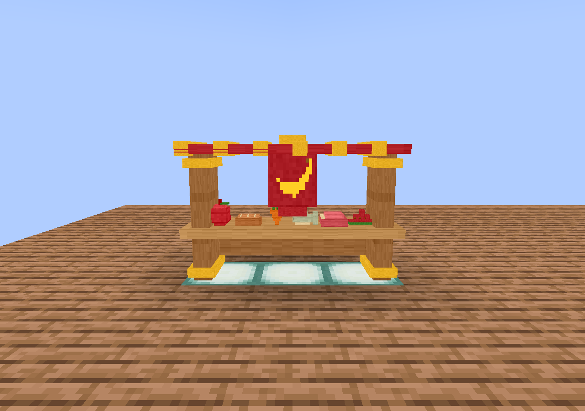
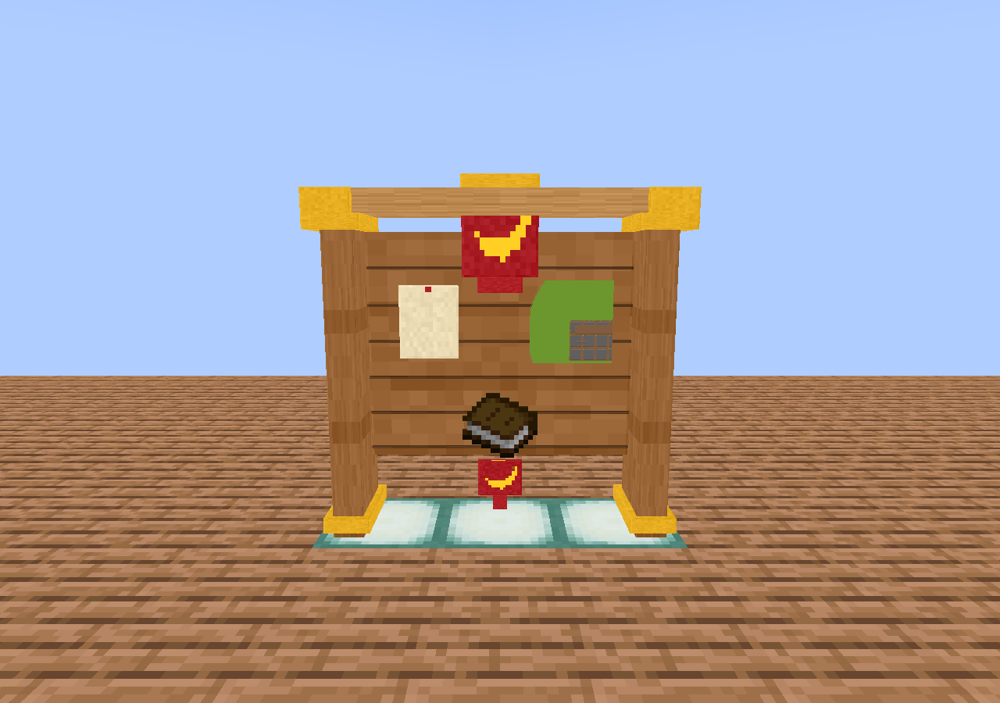
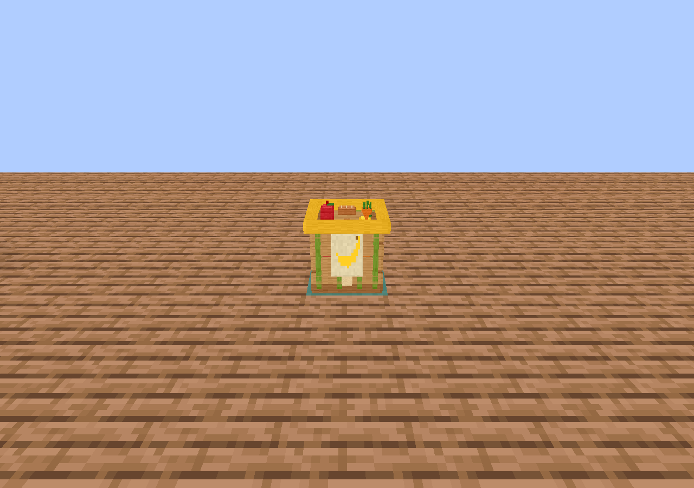

# Minecraft 1.20.1 — игровые снимки 1.12.0

Настоящий клиент Fabric, Xvfb/Mesa. Кадры не ретушировались; source-превью хранятся отдельно.

| Объект | Пусто | Заполнено | Сбоку | Сзади | Сверху |
| --- | --- | --- | --- | --- | --- |
| food_shelf | [empty](00-monkey_king_food_shelf-empty.png) | [filled](01-monkey_king_food_shelf-filled.png) | [side](02-monkey_king_food_shelf-side.png) | [back](03-monkey_king_food_shelf-back.png) | [top](04-monkey_king_food_shelf-top.png) |
| preparation_table | [empty](05-monkey_king_preparation_table-empty.png) | [filled](06-monkey_king_preparation_table-filled.png) | [side](07-monkey_king_preparation_table-side.png) | [back](08-monkey_king_preparation_table-back.png) | [top](09-monkey_king_preparation_table-top.png) |
| supply_basket | [empty](10-monkey_king_supply_basket-empty.png) | [filled](11-monkey_king_supply_basket-filled.png) | [side](12-monkey_king_supply_basket-side.png) | [back](13-monkey_king_supply_basket-back.png) | [top](14-monkey_king_supply_basket-top.png) |
| drying_rack | [empty](15-monkey_king_drying_rack-empty.png) | [filled](16-monkey_king_drying_rack-filled.png) | [side](17-monkey_king_drying_rack-side.png) | [back](18-monkey_king_drying_rack-back.png) | [top](19-monkey_king_drying_rack-top.png) |
| courtyard_gong | [empty](20-monkey_king_courtyard_gong-empty.png) | [filled](21-monkey_king_courtyard_gong-filled.png) | [side](22-monkey_king_courtyard_gong-side.png) | [back](23-monkey_king_courtyard_gong-back.png) | [top](24-monkey_king_courtyard_gong-top.png) |
| festival_bench | [empty](25-monkey_king_festival_bench-empty.png) | [filled](26-monkey_king_festival_bench-filled.png) | [side](27-monkey_king_festival_bench-side.png) | [back](28-monkey_king_festival_bench-back.png) | [top](29-monkey_king_festival_bench-top.png) |
| notice_board | [empty](30-monkey_king_notice_board-empty.png) | [filled](31-monkey_king_notice_board-filled.png) | [side](32-monkey_king_notice_board-side.png) | [back](33-monkey_king_notice_board-back.png) | [top](34-monkey_king_notice_board-top.png) |
| festival_drum | [empty](35-monkey_king_festival_drum-empty.png) | [filled](36-monkey_king_festival_drum-filled.png) | [side](37-monkey_king_festival_drum-side.png) | [back](38-monkey_king_festival_drum-back.png) | [top](39-monkey_king_festival_drum-top.png) |

## Дополнительные состояния

- [40-all-vanilla-foods](40-all-vanilla-foods.png)
- [41-basket-menu](41-basket-menu.png)
- [42-bench-seated](42-bench-seated.png)
- [43-monkey-tab](43-monkey-tab.png)
- [44-combo-44](44-combo-44.png)
- [45-combo-45](45-combo-45.png)
- [46-combo-46](46-combo-46.png)
- [47-combo-47](47-combo-47.png)
- [48-combo-48](48-combo-48.png)
- [49-combo-49](49-combo-49.png)

